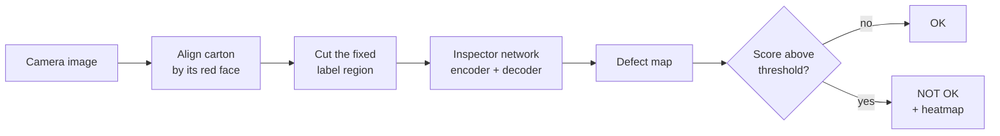

# Package Defect Detection

Automated inspection of the printed code on Tapal tea cartons. A camera on the packaging line photographs each carton; this system decides **OK** or **NOT OK** from the appearance of the dot-matrix print (price, batch, manufacture and expiry dates) and shows where the defect is.

It does not read the text. There is no OCR anywhere in the pipeline: the print is judged as a picture. Checking that the printed *content* is correct is out of scope.

This is the code for an MS thesis. It is research code, tested on one product, one line and one camera.

## How it works



1. **Align.** The carton face is found by colour and the frame is rotated level. No trained model.
2. **Crop.** A fixed region of the face, where the print normally sits, is cut out. The region is measured once from annotated good cartons.
3. **Inspect.** An encoder-decoder network outputs a defect map: for each pixel, the probability that the print is defective there.
4. **Decide.** The carton's score is the mean of the strongest values in the map. Above the threshold, the carton is NOT OK.

### Training without real defects

Real defective cartons are rare, so the network is trained on good cartons only, plus defects made by a synthetic generator. Each crop is separated into a background layer (the carton without print) and an ink layer. Every defect is an edit to the ink: weaken it, remove part of it, move it or add more. Ten types are generated, each at a continuous severity and with a pixel mask:

`fade` · `partial_character` · `nozzle_dropout` · `missing_characters` · `missing_line` · `cut_off` · `line_shift` · `skew` · `smudge` · `no_print`

Two kinds of good image are mixed into training so the network cannot cheat: cartons with a patch of plain carton rebuilt (*retouched*) and cartons with their print lifted and drawn back in place (*redrawn*). Without the second, the network learned "redrawn print means defect" and rejected every redrawn good carton. The evaluation checks both.

Real defective cartons are used for testing only, never for training or for choosing a threshold.

## Current results

ResNet-34 encoder, three training runs with different seeds, mean ± spread.

| Measure | Result |
|---|---|
| Real NOT OK cartons caught | 96.7% ± 1.9 |
| Blank flap (71 images) | 100% in every run |
| Wrong carton side (59 images) | 88% to 100% |
| Print cut off at the carton edge (32 images) | 78% to 100% |
| Good cartons rejected | 3.4% ± 3.7, all of them cartons with a print time not seen in training |
| Synthetic defects caught | 99.6% |
| Defect map quality on synthetic defects (pixel AUROC) | 0.993 |
| Time per carton on an RTX 4070 Super | about 4 ms |

Read these with the limits below in mind.

## Known limitations

- **The dataset is small.** 346 images come from 41 unique camera frames. The real test evidence is 8 defective frames and 6 good ones, so the percentages above are less certain than they look.
- **All training cartons are from five minutes of production**, with the same price, batch and date. The network treats unseen content, such as a new print time, as a defect. Good cartons from every batch in production must be in the training set.
- **The real defects are gross ones**: blank flap, wrong side, print cut off. Performance on fine defects (missing dots, partial characters, smudges, fading) is measured on synthetic images only.
- **Print cut off at the carton edge is caught unreliably.** The remaining characters are well formed and the lost ones are off the carton, so the only clue is the gap where the print should start.
- **Upside-down cartons are not corrected.** Colour cannot tell 0° from 180°.
- **Not yet run on a Jetson Nano.** The deployment code is tested with ONNX Runtime on a PC. The TensorRT path is written but untested.
- **Only the CNN baseline exists so far.** The comparison with a pure Vision Transformer and a hybrid CNN-ViT encoder, the subject of the thesis, is still to be done.

## Repository layout

```
src/
  config.py            paths and device
  preprocessing/       dataset split, annotation tool, carton alignment, label crops
  generator/           synthetic defect generator, preview sheets, synthetic test set
  inspector/           the network, training data, training
  evaluation/          thresholds, metrics, shortcut checks, defect-map pictures
  deploy/              export for the Jetson Nano and the script that runs there
  legacy/              first version of the pipeline, kept for reference
results/               evaluation output and review sheets
```

Not in the repository: the images (`data/`), trained weights (`weights/`) and deployment bundles (`deploy_bundle/`).

## Setup

Python 3.12 on Windows with an NVIDIA GPU is what this was developed on.

```bash
python -m venv .venv
source .venv/Scripts/activate        # Git Bash on Windows
pip install -r requirements.txt
```

`pip install torch` gives a CPU-only build on Windows. For the GPU, install PyTorch with the command from [pytorch.org/get-started/locally](https://pytorch.org/get-started/locally), then check:

```bash
python -c "import torch; print(torch.cuda.is_available())"
```

Set the dataset and repository paths at the top of `src/config.py`.

## Running the pipeline

All commands run from `src/`.

| Step | Command | What it does |
|---|---|---|
| 1 | `python -m preprocessing.split_dataset` | Splits images into train, validation and test by camera frame |
| 2 | `python -m preprocessing.annotate_aligned` | Opens the tool for marking the print block on each image |
| 3 | `python -m preprocessing.build_crops` | Measures the label region and writes all label crops |
| 4 | `python -m generator.make` | Writes defect review sheets and the synthetic test set |
| 5 | `python -m inspector.train` | Trains the inspector, three seeds |
| 6 | `python -m evaluation.evaluate` | Evaluates and writes results and defect-map pictures |
| 7 | `python -m deploy.export` | Packages the best model for the Jetson Nano |

Steps 1 to 3 are only repeated when images are added.

Other encoders use the same commands with `--encoder`, for example `python -m inspector.train --encoder resnet18` and `python -m evaluation.evaluate --encoder resnet18`. Any `timm` model that returns multi-scale feature maps works.

## Deployment on a Jetson Nano

On the workstation:

```bash
python -m deploy.export
```

This writes `deploy_bundle/resnet34/` with `model.onnx`, `bundle.json` (threshold, crop region, alignment settings) and `jetson_inspector.py`, and checks that the bundle gives the same crops, scores and verdicts as the PyTorch pipeline.

Copy that folder to the Jetson. The script there needs only NumPy and OpenCV, which come with JetPack, plus either TensorRT with PyCUDA or ONNX Runtime. It runs on Python 3.6.

```bash
# once, on the Jetson: build the TensorRT engine
/usr/src/tensorrt/bin/trtexec --onnx=model.onnx --saveEngine=model.engine --fp16

python3 jetson_inspector.py --bundle . --benchmark carton.bmp      # time each stage
python3 jetson_inspector.py --bundle . --watch /srv/ftp/incoming --out ~/inspection --save-maps
```

In `--watch` mode every image the camera uploads to the folder is inspected, logged to `log.csv` and moved to `ok/` or `not_ok/`.

## Evaluation outputs

`results/evaluation/<model>/` holds, for each seed, a table of every test image with its score and verdict, and a picture of each mistake next to its defect map. `summary.csv` has one row per seed plus the mean and spread.

`results/evaluation/resnet34_noredraw/` is the earlier model trained without redrawn good cartons, kept as a record of the shortcut it learned.
