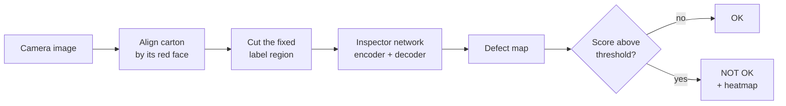

# Package Defect Detection

Automated inspection of the printed code on Tapal tea cartons. A camera on the packaging line photographs each carton; this system decides **OK** or **NOT OK** from the appearance of the dot-matrix print (price, batch, manufacture and expiry dates) and shows where the defect is.

It does not read the text. There is no OCR anywhere in the pipeline: the print is judged as a picture. Checking that the printed *content* is correct is out of scope.

This is the code for an MS thesis. It is research code, tested on one product, one line and one camera.

## How it works



1. **Align.** The carton face is found by colour and the frame is rotated level. No trained model.
2. **Crop.** A fixed region of the face, where the print normally sits, is cut out. The region is measured once from annotated good cartons.
3. **Inspect.** An encoder-decoder network outputs a defect map: for each pixel, the probability that the print is defective there.
4. **Decide.** The carton's score is the mean of the strongest values in the map. Above the threshold, the carton is NOT OK.

### Training without real defects

Real defective cartons are rare, so the network is trained on good cartons only, plus defects made by a synthetic generator. Each crop is separated into a background layer (the carton without print) and an ink layer. Every defect is an edit to the ink: weaken it, remove part of it, move it or add more. Ten types are generated, each at a continuous severity and with a pixel mask:

`fade` · `partial_character` · `nozzle_dropout` · `missing_characters` · `missing_line` · `cut_off` · `line_shift` · `skew` · `smudge` · `no_print`

Two kinds of good image are mixed into training so the network cannot cheat: cartons with a patch of plain carton rebuilt (*retouched*) and cartons with their print lifted and drawn back in place (*redrawn*). Without the second, the network learned "redrawn print means defect" and rejected every redrawn good carton. The evaluation checks both.

Real defective cartons are used for testing only, never for training or for choosing a threshold.

## Data

One production day (15 March 2023): 5,207 good cartons captured between 11:15 and 13:43, and 25 real NOT OK cartons (unsealed, missing print, print off the edge, wrong angle, glare, wrong side). Images are 512 x 480.

Good cartons are split by the minute they were captured in: 35 minutes for training, 6 for validation and 4 for testing. The validation and test cartons therefore carry print times the model has never seen, which is what happens on the line every day. All NOT OK cartons are test-only.

## Results

ResNet-34 encoder, three training runs with different seeds. Test data: 655 good cartons from four capture minutes that were held out of training, and the 25 real NOT OK cartons.

| Measure | Result |
|---|---|
| Good cartons rejected | 0.2% (1 or 2 of 655 per run), all with print times never seen in training |
| Real NOT OK cartons caught | 22 or 23 of 25 per run |
| Real NOT OK cartons with a fault visible in the label region | 22 of 22 in every run |
| Synthetic defects caught | 99.5% |
| Defect map quality on synthetic defects (pixel AUROC) | 0.993 |
| Time per carton on an RTX 4070 Super | about 5 ms |

Three of the 25 NOT OK cartons show a complete, well-formed print in the label region; whatever is wrong with them is outside the part of the carton this system looks at. Two of them are missed by every run and one by one run.

Read these with the limits below in mind.

## Known limitations

- **One production day, one batch.** Every carton has the same price, batch number and dates; only the print time changes. A model trained on this will probably reject another batch until good cartons from it are added to training.
- **Only 25 real defective cartons**, and they are gross faults. Performance on fine defects (missing dots, partial characters, smudges, fading) is measured on synthetic images only.
- **Print cut off at the carton edge is caught unreliably.** The remaining characters are well formed and the lost ones are off the carton, so the only clue is the gap where the print should start.
- **Upside-down cartons are not corrected.** Colour cannot tell 0° from 180°.
- **Only the label region is inspected.** A fault elsewhere on the carton is not seen.
- **Not yet run on a Jetson Nano.** The deployment code and the demo window are tested with ONNX Runtime on a PC. The TensorRT path is written but untested.
- **Only the CNN baseline exists so far.** The comparison with a pure Vision Transformer and a hybrid CNN-ViT encoder, the subject of the thesis, is still to be done.

## Repository layout

```
src/
  config.py            paths and device
  preprocessing/       dataset split, annotation tool, carton alignment, label crops
  generator/           synthetic defect generator, preview sheets, synthetic test set
  inspector/           the network, training data, training
  evaluation/          thresholds, metrics, shortcut checks, defect-map pictures
  deploy/              export for the Jetson Nano, the inspection engine and the demo window
  viz.py               captions and defect-map overlays for the pictures
results/               evaluation output and review sheets
```

Not in the repository: the images (`data/`), trained weights (`weights/`) and deployment bundles (`deploy_bundle/`).

## Setup

Python 3.12 on Windows with an NVIDIA GPU is what this was developed on.

```bash
python -m venv .venv
source .venv/Scripts/activate        # Git Bash on Windows
pip install -r requirements.txt
```

`pip install torch` gives a CPU-only build on Windows. For the GPU, install PyTorch with the command from [pytorch.org/get-started/locally](https://pytorch.org/get-started/locally), then check:

```bash
python -c "import torch; print(torch.cuda.is_available())"
```

Set the dataset and repository paths at the top of `src/config.py`.

## Running the pipeline

All commands run from `src/`.

| Step | Command | What it does |
|---|---|---|
| 1 | `python -m preprocessing.split_dataset` | Splits images into train, validation and test by capture minute |
| 2 | `python -m preprocessing.build_crops` | Writes all label crops and checks each one automatically |
| 3 | `python -m generator.make` | Writes defect review sheets and the synthetic test set |
| 4 | `python -m inspector.train` | Trains the inspector, three seeds |
| 5 | `python -m evaluation.evaluate` | Evaluates and writes results and defect-map pictures |
| 6 | `python -m evaluation.audit_train` | Shows the highest-scoring good training cartons, to find mislabelled ones |
| 7 | `python -m deploy.export` | Packages the best model for the Jetson Nano |

Steps 1 and 2 are only repeated when images are added.

The label region is stored in `weights/crop_region.json`. It only has to be measured again if the camera is moved: annotate some good cartons with `python -m preprocessing.annotate_aligned`, then run `python -m preprocessing.build_crops --remeasure`.

Training time does not depend on the size of the dataset. Each epoch draws a fixed number of random training cartons (`--samples-per-epoch`, default 1,500) and makes a fresh defect for half of them.

Other encoders use the same commands with `--encoder`, for example `python -m inspector.train --encoder resnet18` and `python -m evaluation.evaluate --encoder resnet18`. Any `timm` model that returns multi-scale feature maps works.

## Deployment and demo

On the workstation:

```bash
python -m deploy.export
```

This writes `deploy_bundle/resnet34/` with `model.onnx`, `bundle.json` (threshold, crop region, alignment settings), `jetson_inspector.py` and `jetson_gui.py`, and checks that the bundle gives the same crops, scores and verdicts as the PyTorch pipeline. The two scripts need only NumPy, OpenCV and either ONNX Runtime or TensorRT with PyCUDA. They run on Python 3.6.

### The demo window

```bash
python deploy_bundle/resnet34/jetson_gui.py          # on the workstation, to try it
python3 jetson_gui.py                                # on the Jetson, inside the bundle folder
```

| Mode | What it does |
|---|---|
| Folder of images | Inspects the images already in a folder, one after another |
| Live | Waits for images to arrive in a folder (the camera's FTP target) and inspects each as soon as its upload has finished |

For every carton the window shows the camera image with the inspected region outlined, the label crop, the defect map, the verdict with its confidence, the defect score and the time each stage took. Clicking a row in the list shows that carton again.

The results folder receives `log.csv` (one row per carton) and, for every NOT OK carton, the camera image (`not_ok/`) and a captioned picture with the defect map (`maps/`). In live mode inspected images are moved out of the watched folder into `ok/` or `not_ok/`.

**Confidence** is how far the score is from the threshold: 50% at the threshold, 100% at a score of 0 (OK) or 1 (NOT OK). It is a margin, not a calibrated probability.

### On the Jetson Nano

Copy the bundle folder to the Jetson, then:

```bash
sudo apt-get install python3-tk                      # for the window
# once: build the TensorRT engine (takes several minutes)
/usr/src/tensorrt/bin/trtexec --onnx=model.onnx --saveEngine=model.engine --fp16

python3 jetson_inspector.py --bundle . --benchmark carton.bmp      # time each stage
python3 jetson_gui.py --watch /path/to/ftp/folder                  # the window, live mode filled in
```

The same inspection without a screen: `python3 jetson_inspector.py --bundle . --watch FOLDER --out DIR` or `--folder FOLDER`.

## Evaluation outputs

`results/evaluation/<model>/` holds, for each seed, a table of every test image with its score and verdict, and a picture of each mistake next to its defect map. `summary.csv` has one row per seed plus the mean and spread.
